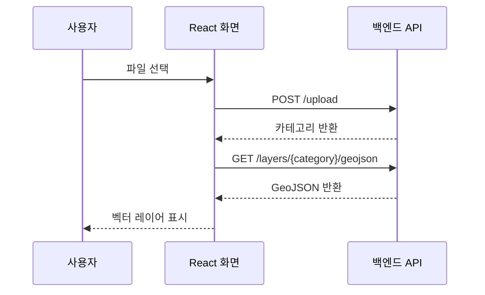

# 환경 공간데이터 관리·시각화 플랫폼

환경 공간데이터를 업로드하고 지도에서 조회하며, 필요한 영역과 파일 형식을 선택해 다운로드하는 웹 플랫폼입니다. 이 저장소는 학교 캡스톤 팀 프로젝트의 **React·Leaflet 기반 프론트엔드**를 소개합니다.

[백엔드 저장소](https://github.com/km-jun/p02-backend-portfolio) · [실행 방법](docs/running.md) · [개발 당시 팀 문서](docs/team-readme.md)

## 프로젝트 개요

| 항목 | 내용 |
|---|---|
| 개발 기간 | 2026.03~2026.05 |
| 프로젝트 형태 | 학교 캡스톤 팀 프로젝트 |
| 주요 기능 | 공간 데이터 업로드, 지도 시각화, 레이어 관리, 영역 선택, 변환·다운로드 요청 |
| 프론트엔드 기술 | React, JavaScript, Leaflet, react-leaflet, react-dropzone, axios |
| 배포 경험 | Vercel 프론트엔드와 AWS 기반 백엔드 연동 |

현재는 기존 AWS 환경에 접근할 수 없어 운영 데모를 제공하지 않습니다. 아래 내용은 코드와 개발 기록을 바탕으로 정리했습니다.

## 담당 역할

팀장으로서 프로젝트 진행과 보고서 작성을 맡았습니다. 당시 역할 정리에는 공간 DB 설계, PostGIS·JSONB 모델링, 프론트엔드와 지도 UI 개발, AWS EC2·S3 구축 및 Vercel 배포가 포함돼 있습니다.

이 저장소에서는 프론트엔드 작업을 중심으로 소개합니다.

- React·Leaflet 기반 지도 화면과 파일 업로드·다운로드 UI 구성
- 지도 레이어와 사용자 선택 상태를 화면에 반영
- 업로드, 공간 조회, 변환 작업 상태 확인 API 연동
- Vercel 배포 설정과 백엔드 연결 작업

UI와 시각화 기능에는 팀원 기여도 포함돼 있습니다. 아래 구현 설명은 팀 결과물의 코드 흐름을 설명하며, 모든 기능을 단독 구현했다는 의미는 아닙니다. [역할과 기록의 범위](docs/publication-notes.md#역할과-기록의-범위)

## 주요 화면과 기능

| 화면 영역 | 사용자 기능 | 관련 코드 |
|---|---|---|
| 파일 업로드 | 파일을 드래그해 업로드하고 전송 진행률 확인 | [DropZone](src/components/Sidebar/DropZone.jsx), [Sidebar](src/components/Sidebar/Sidebar.jsx) |
| 지도 | GeoJSON 표시, 속성 툴팁, 지도 이동·확대 | [MapView](src/components/Map/MapView.jsx) |
| 레이어 패널 | 레이어 표시·숨김, 그룹 구성과 순서 관리 | [LayerPanel](src/components/Map/LayerPanel.jsx) |
| 영역 선택 | 지도에서 사각형 범위를 지정해 다운로드 조건에 반영 | [MapView](src/components/Map/MapView.jsx) |
| 다운로드 | 카테고리·파일 형식·지역을 선택하고 처리 상태 및 결과 링크 확인 | [Sidebar](src/components/Sidebar/Sidebar.jsx) |

## 구현 흐름

### 파일 업로드 후 지도에 표시

파일을 `FormData`로 업로드 API에 전달합니다. 벡터 파일은 응답으로 받은 카테고리를 이용해 GeoJSON을 조회한 뒤 지도 레이어에 추가합니다. TIF는 별도 래스터 레이어로 등록하는 분기를 사용합니다.

위 흐름은 벡터 파일 기준입니다. 파일 파싱·변환과 DB 저장은 백엔드가 담당합니다.

### 지도 영역을 조회 조건으로 전달

`MapView`는 지도 이동·확대가 끝나면 현재 화면의 경위도 범위를 구합니다. `LayerPanel`은 표시 중인 레이어와 범위를 `/spatial/search`에 전달합니다. 범위가 바뀐 뒤 500ms를 기다리고, 대기 중 다시 변경되면 이전 타이머를 취소하도록 구현돼 있습니다.

### 변환 요청과 완료 상태 표시

선택한 카테고리·파일 형식·지역·영역을 `/spatial/query`에 전달합니다. 응답의 작업 ID로 상태를 2초 간격으로 조회하고, 완료되면 다운로드 링크를 표시합니다. 상태가 완료 또는 실패이면 반복 조회를 중단합니다.

## 구현 과정에서 보완한 점

### 파일명과 API 입력 규칙 맞추기

파일명에서 확장자를 제거한 값을 카테고리로 사용할 때, 특수문자와 길이를 처리하는 코드가 추가됐습니다. 프론트엔드에서 허용하지 않는 문자를 `_`로 바꾸고 50자로 제한한 뒤 업로드합니다. [구현 코드](src/components/Sidebar/Sidebar.jsx)

### 전송 진행률과 변환 상태 구분하기

업로드는 axios의 전송 이벤트로 진행률을 표시합니다. 다운로드 준비 과정은 백엔드 작업 상태를 조회해 대기·처리·완료·실패로 표시합니다. 이때 다운로드 진행 바의 값은 상태에 대응한 표시값이며, 실제 변환 작업량을 측정한 퍼센트는 아닙니다. [구현 코드](src/components/Sidebar/Sidebar.jsx)

두 항목은 커밋과 코드에서 확인되는 변경 내용입니다. 성능 향상 수치는 별도로 측정하지 않았습니다.

## 기술 구성

| 용도 | 기술 |
|---|---|
| 화면과 상태 관리 | React, JavaScript |
| 지도·도형 선택 | Leaflet, react-leaflet, leaflet-draw |
| 파일 선택과 HTTP 요청 | react-dropzone, axios |
| 레이어 순서 변경 | dnd-kit |
| 배포 설정 | Vercel |
| 연동 백엔드 | FastAPI, PostgreSQL·PostGIS, AWS S3 |

## 실행 및 관련 자료

- [로컬 실행과 배포 안내](docs/running.md)
- [백엔드 코드와 DB·인프라 설명](https://github.com/km-jun/p02-backend-portfolio)
- [개발 당시 팀 문서](docs/team-readme.md)
- [개발 이력 보존과 공개용 정리 내역](docs/publication-notes.md)

공개용 사본을 준비하면서 프론트엔드 빌드를 확인했습니다. 현재 백엔드와의 통합 실행은 재검증하지 않았습니다.
