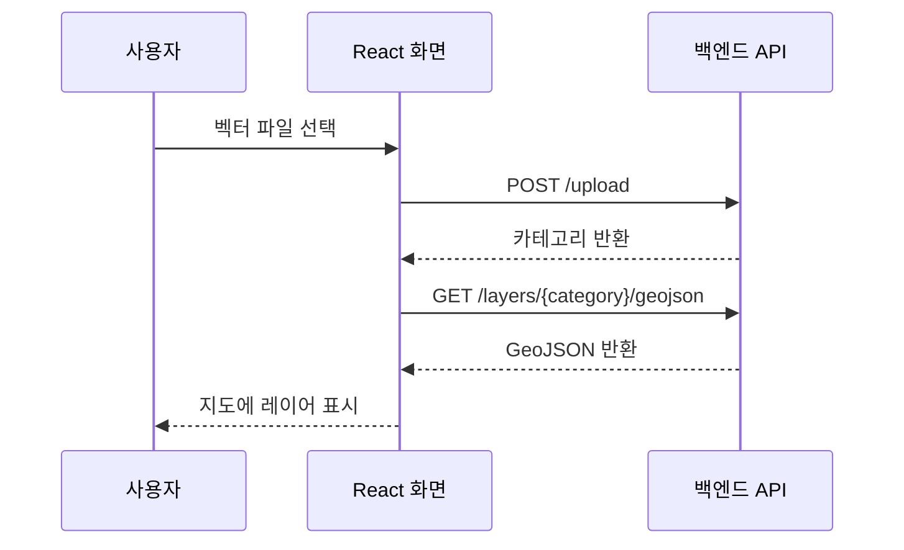

# 환경 공간데이터 관리·시각화 플랫폼

환경 공간데이터를 업로드하고 지도에서 조회하며, 필요한 영역과 파일 형식을 선택해 다운로드하는 웹 플랫폼입니다. 이 저장소는 학교 캡스톤 팀 프로젝트의 **React·Leaflet 기반 프론트엔드**를 소개합니다.

[백엔드 저장소](https://github.com/km-jun/p02-backend-portfolio) · [실행 방법](docs/running.md)

## 프로젝트 개요

| 항목 | 내용 |
|---|---|
| 개발 기간 | 2026.03~2026.05 |
| 프로젝트 형태 | 학교 캡스톤 팀 프로젝트 |
| 주요 기능 | 공간 데이터 업로드, 지도 시각화, 레이어 관리, 영역 선택, 변환·다운로드 요청 |
| 프론트엔드 기술 | React, JavaScript, Leaflet, react-leaflet, react-dropzone, axios |
| 배포 경험 | Vercel 프론트엔드와 AWS 기반 백엔드 연동 |

## 담당 역할

**팀장으로 프로젝트 진행을 관리하고, 공간 DB 설계·프론트엔드 개발·AWS 인프라 구축과 배포를 맡았습니다.**

| 구분 | 담당 내용 |
|---|---|
| 프로젝트 관리 | 진행 관리 및 보고서 작성 |
| 프론트엔드 | React 기반 웹 화면, Leaflet 지도 UI 개발 및 API 연동 |
| 데이터베이스 | DB 구조 설계, PostGIS·JSONB 모델링 |
| 인프라·배포 | AWS EC2·S3 구축, Vercel 배포 및 백엔드 연결 |

팀원과 함께 개발한 결과물입니다. 발표와 일부 백엔드 로직은 팀원이 담당했고, UI와 지도 시각화에도 팀원 기여가 포함돼 있습니다. 이 README는 그중 프론트엔드의 기능과 구현 흐름을 소개합니다.

## 주요 기능

| 화면 영역 | 사용자 기능 | 관련 코드 |
|---|---|---|
| 파일 업로드 | 파일을 드래그해 업로드하고 전송 진행률 확인 | [DropZone](src/components/Sidebar/DropZone.jsx), [Sidebar](src/components/Sidebar/Sidebar.jsx) |
| 지도 | GeoJSON 표시, 속성 툴팁, 지도 이동·확대 | [MapView](src/components/Map/MapView.jsx) |
| 레이어 패널 | 레이어 표시·숨김, 그룹 구성과 순서 관리 | [LayerPanel](src/components/Map/LayerPanel.jsx) |
| 영역 선택 | 지도에서 사각형 범위를 지정해 다운로드 조건에 반영 | [MapView](src/components/Map/MapView.jsx) |
| 다운로드 | 카테고리·파일 형식·지역을 선택하고 처리 상태 및 결과 링크 확인 | [Sidebar](src/components/Sidebar/Sidebar.jsx) |

## 구현 과정

### 파일 업로드와 지도 표시 연결

파일을 `FormData`로 업로드 API에 전달하고, 응답으로 받은 카테고리로 GeoJSON을 조회해 지도 레이어에 추가합니다. 파일 파싱·변환과 DB 저장은 백엔드에서 처리합니다.

파일명을 카테고리로 전달할 때는 확장자를 제거하고, 허용하지 않는 문자를 `_`로 치환하며 길이를 50자로 제한합니다. 업로드 요청이 API의 입력 규칙에 맞도록 처리한 부분입니다. [관련 코드](src/components/Sidebar/Sidebar.jsx)

### 화면 영역 조회와 다운로드 상태 표시

지도 이동·확대가 끝나면 현재 화면의 경위도 범위를 구해 표시 중인 레이어와 함께 `/spatial/search`에 전달합니다. 범위가 바뀐 뒤 500ms를 기다리고, 그 사이 다시 변경되면 이전 타이머를 취소합니다. [지도 이벤트](src/components/Map/MapView.jsx) · [조회 요청](src/components/Map/LayerPanel.jsx)

다운로드는 사용자가 선택한 카테고리·파일 형식·지역·영역을 `/spatial/query`로 전달합니다. 작업 ID로 상태를 2초 간격으로 확인해 대기·처리·완료·실패를 표시하고, 완료되면 다운로드 링크를 제공합니다. 다운로드 진행 바는 작업 상태별 표시값이며 실제 변환량을 측정한 값은 아닙니다. [관련 코드](src/components/Sidebar/Sidebar.jsx)

## 기술 구성

| 용도 | 기술 |
|---|---|
| 화면과 상태 관리 | React, JavaScript |
| 지도·도형 선택 | Leaflet, react-leaflet, leaflet-draw |
| 파일 선택과 HTTP 요청 | react-dropzone, axios |
| 레이어 순서 변경 | dnd-kit |
| 배포 설정 | Vercel |
| 연동 백엔드 | FastAPI, PostgreSQL·PostGIS, AWS S3 |

## 실행 및 관련 자료

- [로컬 실행과 배포 안내](docs/running.md)
- [백엔드 코드와 DB·인프라 설명](https://github.com/km-jun/p02-backend-portfolio)
- [개발 당시 팀 문서](docs/team-readme.md)
- [개발 이력 보존과 공개용 정리 내역](docs/publication-notes.md)

현재는 기존 AWS 무료 플랜 종료로 운영 데모를 제공하지 않습니다. 공개용 정리 당시 프론트엔드 빌드는 통과했으며, 백엔드와의 통합 실행은 재검증하지 않았습니다.
