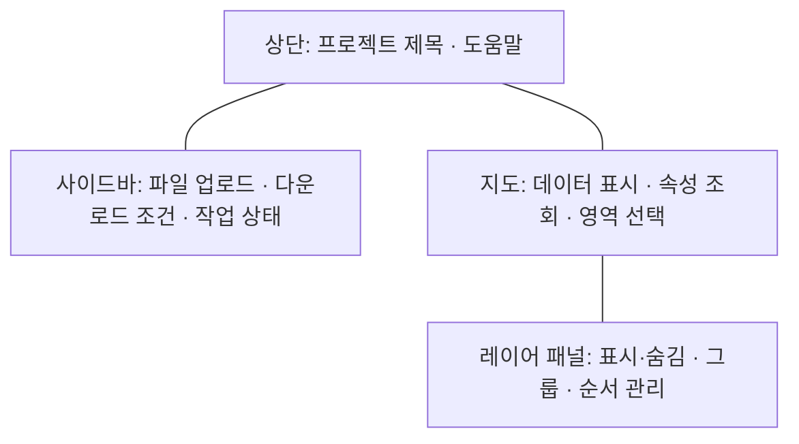
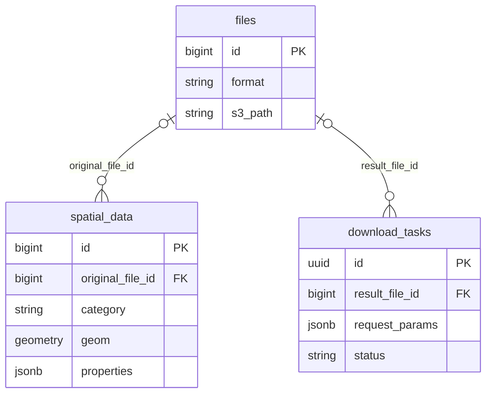
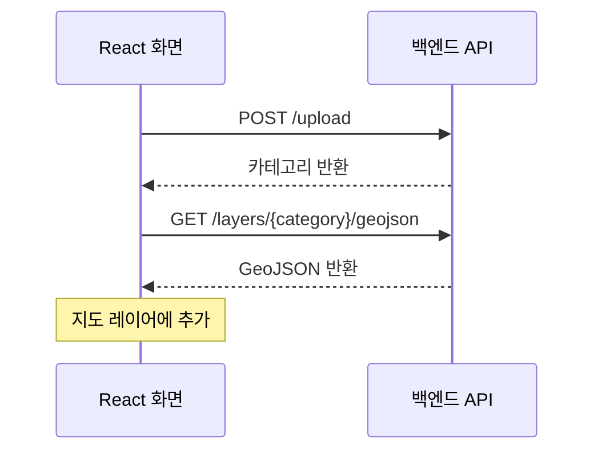

# 환경 공간데이터 관리·시각화 플랫폼

> **공간 데이터를 업로드하고, 지도에서 확인한 뒤 필요한 영역과 형식으로 내려받는 웹 플랫폼**
>
> 학교 캡스톤 팀 프로젝트로 개발한 환경 공간데이터 통합 관리 서비스입니다. 파일 업로드부터 지도 조회와 변환·다운로드 요청까지 하나의 웹 화면에서 연결했습니다. 이 저장소는 React·Leaflet 기반 프론트엔드를 담고 있습니다.

<table>
<tr>
<td width="50%" valign="top">
<h3>Information</h3>

<strong>개발 기간</strong> 2026.03~2026.05

<strong>팀 구성</strong> 학생 4명, 멘토 1명

<strong>담당 역할</strong> 팀장 · 공간 DB 설계 · 프론트엔드 개발 · AWS 인프라 구축 및 배포

<strong>주요 기술</strong> React · JavaScript · Leaflet · axios

<a href="https://github.com/km-jun/p02-backend-portfolio">백엔드 저장소</a> · <a href="docs/running.md">로컬 실행 방법</a>

</td>
<td width="50%" valign="top">
<h3>Review</h3>

<strong>프로젝트 결과</strong> 업로드, 지도 레이어 조회, 영역 선택, 변환·다운로드 요청을 웹 화면과 API로 연결했습니다.

<strong>구현에서 다룬 부분</strong> 지도 화면 범위를 조회 조건으로 전달하고, 파일 전송 진행률과 서버의 변환 작업 상태를 구분해 표시했습니다.

<strong>현재 제약</strong> 기존 AWS 무료 플랜 종료로 운영 데모는 제공하지 않습니다. 공개용 정리 당시 프론트엔드 빌드는 통과했으며, 현재 백엔드와의 통합 실행은 재검증하지 않았습니다.

</td>
</tr>
</table>

---

## 프로젝트 진행 과정

1. [요구사항 정의](#01-요구사항-정의)
2. [화면 구성](#02-화면-구성)
3. [DB 및 인프라 설계](#03-db-및-인프라-설계)
4. [담당 기능 개발](#04-담당-기능-개발)
5. [형상관리 및 협업](#05-형상관리-및-협업)
6. [개발 중 이슈와 보완점](#06-개발-중-이슈와-보완점)

## 01. 요구사항 정의

공간 데이터의 업로드·조회·추출 흐름을 웹에서 사용할 수 있도록 구성했습니다. 아래는 구현된 기능을 기준으로 정리한 요구사항입니다.

| 사용자 요구 | 구현한 기능 |
|---|---|
| 공간 데이터 파일을 올리고 싶다 | 드래그 앤 드롭 업로드, 전송 진행률 표시 |
| 여러 데이터를 지도에서 비교하고 싶다 | GeoJSON 표시, 레이어 표시·숨김, 속성 툴팁 |
| 관심 지역의 데이터를 보고 싶다 | 지도 이동·확대에 따른 화면 범위 조회 |
| 원하는 범위와 형식으로 추출하고 싶다 | 사각형 영역 선택, 카테고리·지역·파일 형식 지정 |
| 변환이 끝났는지 확인하고 싶다 | 작업 상태 조회와 완료 파일 다운로드 링크 |

## 02. 화면 구성

파일 업로드와 다운로드 조건을 설정하는 사이드바, 공간 데이터를 표시하는 지도, 레이어를 관리하는 패널로 구성했습니다.

*현재 코드 구조를 바탕으로 재구성한 화면 구성도이며, 실제 실행 화면이나 당시 화면설계서는 아닙니다.*

| 화면 영역 | 관련 코드 |
|---|---|
| 전체 레이아웃과 상태 전달 | [App.js](src/App.js) |
| 파일 업로드·다운로드 | [Sidebar.jsx](src/components/Sidebar/Sidebar.jsx), [DropZone.jsx](src/components/Sidebar/DropZone.jsx) |
| 지도 표시와 영역 선택 | [MapView.jsx](src/components/Map/MapView.jsx) |
| 레이어 관리 | [LayerPanel.jsx](src/components/Map/LayerPanel.jsx) |

## 03. DB 및 인프라 설계

공간 DB 구조 설계와 PostGIS·JSONB 모델링, AWS EC2·S3 구축 및 Vercel 배포를 담당했습니다. 프론트엔드는 API를 통해 데이터를 요청하고, 백엔드는 DB 조회와 파일 처리를 담당합니다.

| 구성 | 역할 |
|---|---|
| Vercel | React 프론트엔드 배포 |
| AWS EC2 | 백엔드 API 실행 환경 |
| PostgreSQL·PostGIS | 공간 데이터와 도형 저장·조회 |
| JSONB | 공간 객체 속성과 다운로드 요청 조건 저장 |
| AWS S3 | 파일 저장 및 다운로드 연동 |

아래는 공개된 백엔드 모델에서 주요 테이블과 관계만 추린 구성입니다.

*현재 모델을 바탕으로 재구성한 요약 ERD입니다.* 전체 정의는 [백엔드 models.py](https://github.com/km-jun/p02-backend-portfolio/blob/main/app/models.py)에서 확인할 수 있습니다.

## 04. 담당 기능 개발

| 구분 | 담당 내용 |
|---|---|
| 프로젝트 관리 | 팀장으로 진행 관리 및 보고서 작성 |
| 프론트엔드 | React 화면, Leaflet 지도 UI 개발 및 API 연동 |
| 데이터베이스 | DB 구조 설계, PostGIS·JSONB 모델링 |
| 인프라·배포 | AWS EC2·S3 구축, Vercel 배포 및 백엔드 연결 |

팀 공동 결과물이며 발표와 일부 백엔드 로직은 팀원이 담당했습니다. UI와 지도 시각화에도 팀원 기여가 포함돼 있습니다. 다음은 프론트엔드에 반영된 대표 구현 흐름입니다.

### 파일 업로드와 지도 표시

파일을 `FormData`로 `/upload`에 전달합니다. 벡터 파일은 응답의 카테고리로 GeoJSON을 조회한 뒤 지도 레이어에 추가합니다. 파일 파싱·변환과 DB 저장은 백엔드에서 처리합니다.

[업로드·응답 처리 코드](src/components/Sidebar/Sidebar.jsx)

### 지도 영역 조회와 다운로드 연동

지도 이동·확대가 끝나면 현재 화면의 경위도 범위를 구해 표시 중인 레이어와 함께 `/spatial/search`에 전달합니다. 범위가 바뀐 뒤 500ms를 기다리고, 그 사이 다시 변경되면 이전 타이머를 취소합니다.

다운로드 요청에는 카테고리·파일 형식·지역·선택 영역을 담습니다. 응답의 작업 ID로 상태를 2초 간격으로 확인하고, 완료되면 파일 링크를 표시합니다.

[지도 이벤트](src/components/Map/MapView.jsx) · [공간 조회 요청](src/components/Map/LayerPanel.jsx) · [다운로드 상태 처리](src/components/Sidebar/Sidebar.jsx)

## 05. 형상관리 및 협업

Git과 GitHub로 변경 내용을 관리했습니다. 기능 브랜치에서 작업한 뒤 통합하는 방식으로 진행했으며, 이 공개용 저장소에는 작성자 이름·작업 날짜·커밋 메시지와 브랜치 병합 이력을 보존했습니다.

- [커밋 기록](https://github.com/km-jun/p02-frontend-portfolio/commits/main/)
- [브랜치 목록](https://github.com/km-jun/p02-frontend-portfolio/branches)
- [개발 당시 팀 문서](docs/team-readme.md)

원본 PR·댓글은 이전하지 않았습니다. [공개용 정리 내역](docs/publication-notes.md)

## 06. 개발 중 이슈와 보완점

| 항목 | 처리 내용 또는 현재 상태 |
|---|---|
| 파일명과 API 입력 규칙 | 확장자 제거, 허용하지 않는 문자를 `_`로 치환, 카테고리 길이 50자 제한 |
| 전송 진행률과 변환 상태 | 업로드 전송 진행률과 서버 변환 작업 상태를 구분해 표시. 다운로드 진행 바는 상태별 표시값이며 실제 변환량 측정치는 아님 |
| HTTPS 화면에서 HTTP API 호출 | 개발 당시 Mixed Content 이슈가 기록됨. 운영 재개 시 HTTPS 백엔드와 CORS 설정 확인 필요 |

성능 개선 수치는 별도로 측정하지 않았습니다. [실행·배포 안내](docs/running.md)에 환경 설정과 현재 제약을 정리했습니다.

---

[백엔드 포트폴리오](https://github.com/km-jun/p02-backend-portfolio) · [실행 방법](docs/running.md) · [공개용 저장소 안내](docs/publication-notes.md)
